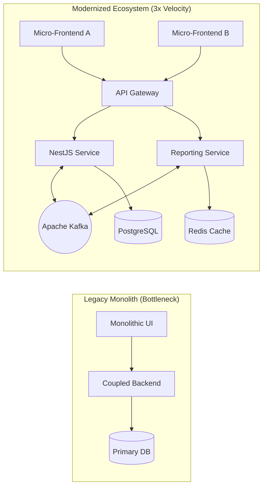
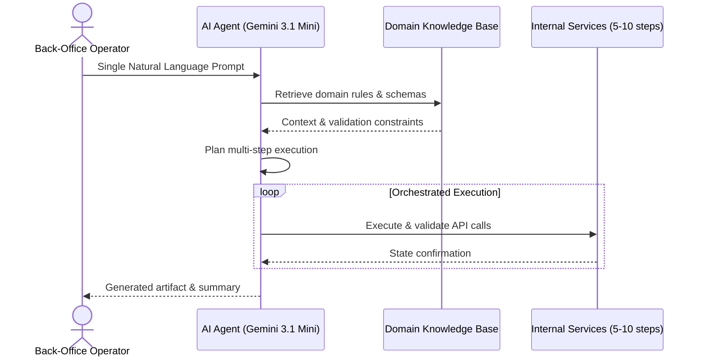

# Vladyslav Magada
### Lead Software Engineer | Full-Stack JS/TS, Distributed Systems & AI Agents

📍 Remote (US EST/EDT & CET overlap) • 💼 [LinkedIn](https://www.linkedin.com/in/vmagada) • ✉️ onexample@gmail.com

12+ years building enterprise SaaS platforms, event-driven backends, and AI workflows. Leading cross-functional engineering teams to modernize legacy systems and ship 25+ production applications and microservices.

---

### 🏗️ Selected Engineering Case Studies

Since my production code lives in private enterprise repositories, below are two real-world architectural challenges I solved and their measurable business impact.

#### 1. Decoupling a Monolithic Enterprise Platform for 3x Faster Delivery
* **Problem:** As a B2B SaaS ecosystem scaled to 25+ components, its legacy monolithic UI and tightly coupled backend created severe deployment bottlenecks. Minor updates required full regression testing, slowing down releases and risking cascading failures during traffic spikes.
* **Solution:** Spearheaded a phased architectural migration without halting feature delivery:
  * **Frontend:** Transitioned from a monolith to independent **Micro-frontends** inside a unified **Monorepo**, modernized tooling (**Webpack → Vite**), and automated pipelines via **GitHub Actions**.
  * **Backend:** Architected fault-tolerant, event-driven microservices (**Node.js, NestJS, Apache Kafka**) with **Redis** caching and GraphQL query optimization for heavy reporting workloads.
  * **Quality:** Led a full codebase migration from **JavaScript to TypeScript** and introduced automated test & code review KPIs.

* **Result:** **3x increase** in release frequency, **40% faster** CI/CD execution, **80% faster** automated test runs, **40% lower** API latency, and **50% fewer** production bugs.

---

#### 2. Replacing Multi-Step Back-Office Workflows with a Custom AI Agent
* **Problem:** Operations teams spent significant manual effort executing repetitive, 5–10 step workflows across multiple internal applications to configure entities and generate system artifacts, causing delays and manual errors.
* **Solution:** Architected and led the end-to-end development of a custom back-office **AI Agent** from scratch using **Gemini 3.1 Mini**. Built a plan-and-execute orchestration workflow backed by a structured domain knowledge base and strict schema validation to safely interact with internal APIs.

* **Result:** Condensed complex **5–10 step cross-application workflows into a single natural language prompt**, eliminating routine configuration errors and reducing operational overhead.

---

### 👨‍💻 Primary Tech Stack

* **Languages:** TypeScript, JavaScript (Node.js), SQL
* **Backend & Messaging:** NestJS, Express, GraphQL, REST, WebSockets, Apache Kafka
* **Frontend & Tooling:** React, Micro-frontends, Redux Toolkit, Vite, Monorepos (Turborepo/Nx)
* **Data & Infrastructure:** PostgreSQL, MySQL, MongoDB, Redis, Docker, Kubernetes, GitHub Actions, AWS (ECS, EKS, Lambda, S3)
* **AI & Productivity:** Agentic Workflows, Gemini API, MCP Servers, Cursor, Claude Code
