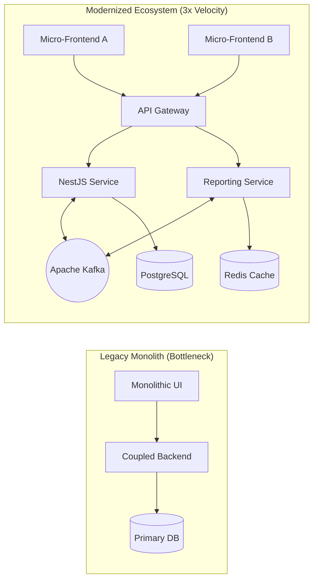
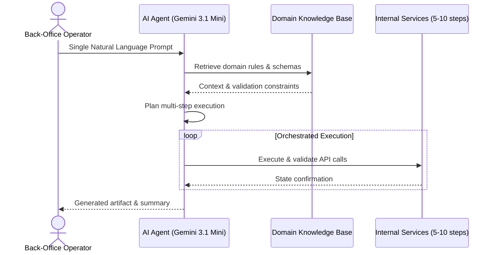

# Vladyslav Magada
### Lead Software Engineer | Full-Stack JS/TS, Distributed Systems & AI Agents

📍 Remote (US EST/EDT & CET overlap) • 💼 [LinkedIn](https://www.linkedin.com/in/vmagada) • ✉️ onexample@gmail.com • 📄 [Resume (PDF)](https://www.linkedin.com/in/vmagada)

Lead Software Engineer with **12+ years of experience** building and scaling **B2B SaaS** and **AdExchange back-office platforms**. Over the past 5+ years, I have led cross-functional engineering teams to modernize legacy architectures, adopt event-driven microservices, and ship **25+ production applications and services** with a 95% on-time roadmap delivery rate.

---

### 🏗️ Selected Engineering Case Studies 

*Note: Due to NDA obligations, client names and proprietary identifiers are omitted; architectural patterns and business metrics reflect real production outcomes.*

#### Case 1: Decoupling a Monolithic Enterprise Platform for 3x Faster Delivery

* **Situation:** As a B2B SaaS ecosystem grew to 25+ integrated components, its legacy monolithic UI and tightly coupled backend became major bottlenecks. Minor feature updates required full regression testing, delaying release cycles, creating cross-team deployment conflicts, and risking cascading failures during traffic spikes.
* **Task:** As Lead Software Engineer, I was tasked with architecting and executing a zero-downtime modernization strategy to decouple deployments, eliminate performance bottlenecks, and scale delivery velocity across a team of 5 engineers without halting ongoing product roadmap features.
* **Action:**
  * **Frontend Decomposition:** Led a phased migration from a monolithic UI to independent **Micro-frontends** inside a unified **Monorepo**, modernized build tooling (**Webpack → Vite**), and rebuilt CI/CD pipelines on **GitHub Actions**.
  * **Backend & Caching Architecture:** Designed and implemented a fault-tolerant, event-driven microservices layer using **Node.js, NestJS, and Apache Kafka**, introducing **Redis** caching and GraphQL query optimization for heavy reporting workloads.
  * **Engineering Governance:** Directed a year-long codebase migration from **JavaScript to TypeScript** and established automated testing and code review KPIs across 25+ services.

* **Result:**
  * **3x increase** in release frequency through independent component deployments.
  * **40% faster** CI/CD execution and **80% faster** automated test runs.
  * **40% reduction** in API response times and **25% faster** administrative dashboard load speeds.
  * **50% drop** in production bug reports following the TypeScript migration and review KPIs.

---

#### Case 2: Replacing Multi-Step Back-Office Workflows with a Custom AI Agent

* **Situation:** Internal operations and back-office teams spent significant manual effort executing repetitive, 5–10 step workflows across multiple internal applications to configure entities and generate system artifacts. This created operational friction, human configuration errors, and slow turnaround times.
* **Task:** I was responsible for designing and leading the end-to-end development of an AI-powered automation solution from scratch that could safely interpret operator intent, orchestrate multi-service actions, and eliminate manual routine work.
* **Action:**
  * **Agentic Architecture:** Architected a plan-and-execute workflow powered by **Gemini 3.1 Mini** capable of breaking down natural language requests into deterministic execution steps rather than relying on simple chat completions.
  * **Knowledge Base & Guardrails:** Structured a domain-specific knowledge base and strict schema validation layer so the agent could reliably interact with internal APIs and generate compliant artifacts without hallucinations.
  * **Team Delivery:** Guided the engineering team through iterative prototyping, edge-case validation, and production rollout into the back-office platform.

* **Result:**
  * Condensed complex **5–10 step cross-application workflows into a single natural language prompt**.
  * Eliminated routine manual configuration errors and substantially reduced back-office operational overhead.

---

### 👨‍💻 Primary Tech Stack

* **Languages:** TypeScript, JavaScript (Node.js), SQL
* **Backend & Messaging:** NestJS, Express, GraphQL, REST, WebSockets, Apache Kafka
* **Frontend & Tooling:** React, Micro-frontends, Redux Toolkit, Vite, Monorepos (Turborepo/Nx)
* **Data & Infrastructure:** PostgreSQL, MySQL, MongoDB, Redis, Docker, Kubernetes, GitHub Actions, AWS (ECS, EKS, Lambda, S3)
* **AI & Productivity:** Agentic Workflows, Gemini API, MCP Servers, Cursor, Claude Code
